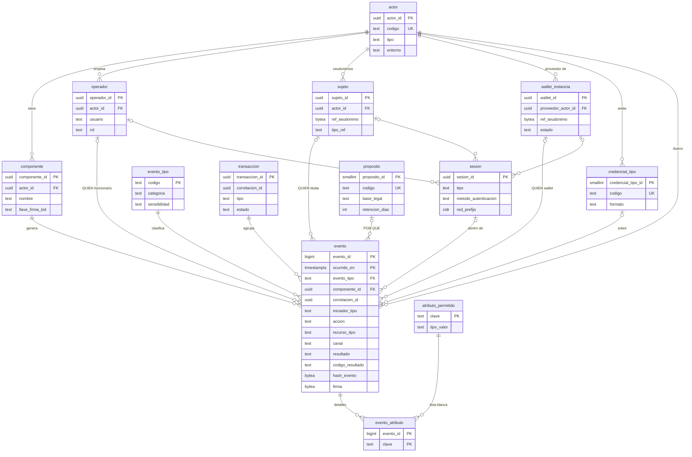
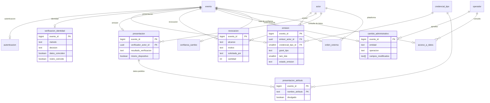
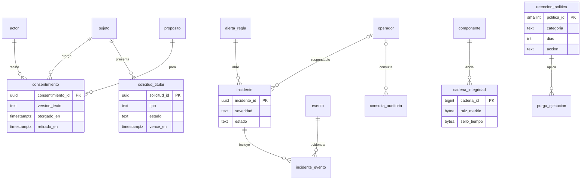

# Propuesta: base de datos de auditoría del ecosistema Avance

**Estado:** propuesta de diseño (no implementada). **Motor:** PostgreSQL 15 o superior (el esquema se probó en PostgreSQL 18.4).
**Fecha:** 2026-11-05.

Este documento propone el modelo entidad-relación y el esquema SQL de una base de datos que registre, de forma persistente y
centralizada, **quién hizo qué, cuándo, dónde, por qué y con qué resultado** en el ecosistema: titulares con su wallet, emisores,
verificadores, servicios de apoyo y funcionarios.

> **Antes de leer el modelo: una advertencia de diseño.** Una base central con el *contenido* de todas las transacciones de todas las
> wallets choca con eIDAS 2.0 y con el ARF: el proveedor de la wallet no debe recopilar su uso, y el emisor no debe poder saber dónde se
> usa lo que emitió (*no vinculación*). Por eso este modelo es **de eventos, no de contenido**: no guarda valores de atributos, ni
> cédulas, ni nombres, ni imágenes, ni la URI ni el índice de la lista de estado de una credencial. Usa **seudónimos distintos por
> actor** para que nadie pueda cruzar lo que ve un emisor con lo que ve un verificador. Pensado para el **entorno simulado (SANDBOX)** y
> como base de la auditoría legítima de cada actor; llevarlo a producción exige la evaluación de impacto de la sección 10.

## 1. Qué contesta una auditoría (las 7 preguntas)

| Pregunta | Dónde se responde |
|---|---|
| **¿Quién?** | `evento.iniciador_tipo` y `sujeto_id` (titular, seudonimizado), `operador_id` (funcionario), `wallet_id` (instancia de wallet), `sesion_id` |
| **¿Qué?** | `evento.evento_tipo`, `accion`, `recurso_tipo`, `recurso_ref`, `credencial_tipo_id` y las tablas de detalle |
| **¿Cuándo?** | `ocurrido_en` (reloj del componente), `registrado_en` (llegada) y la duración |
| **¿Dónde?** | `componente_id` y `actor_id` (qué servicio y de quién), `canal`, `ruta`, `red_prefijo` (IP truncada), `pais` |
| **¿Por qué?** | `proposito_id` (con su base legal), `motivo_codigo`, `motivo_texto`, y `consentimiento` |
| **¿Cómo y con qué resultado?** | `resultado`, `codigo_resultado`, `severidad`, `canal`, `autenticacion.metodo`, `verificacion_identidad.metodo` |
| **¿Es confiable el registro?** | `hash_previo`, `hash_evento`, `firma`, `cadena_integridad` (raíces de Merkle y sello de tiempo) |

## 2. Principios de diseño

1. **Solo inserción.** Nadie modifica ni borra un evento (disparador y permisos). El borrado por retención se hace quitando particiones
   completas, con registro en `purga_ejecucion`.
2. **Eventos, no contenido.** Se guardan hechos y resultados. Los valores de las credenciales se quedan en su emisor.
3. **Seudónimos por actor.** El titular se representa con `HMAC-SHA256(clave_del_actor, identificador)`; cada actor usa su propia clave,
   así que los seudónimos de la Registraduría y de un banco no se pueden unir.
4. **Lista blanca de atributos.** Lo que no esté en `atributo_permitido` no se puede guardar en `evento_atributo`; y esa lista
   prohíbe por restricción marcar un atributo como dato personal.
5. **Integridad verificable.** Cada componente encadena sus eventos con hash y los firma; cada cierto tiempo publica la raíz de Merkle
   con sello de tiempo. Esa tabla se puede entregar a un tercero sin revelar el contenido.
6. **Aislamiento por entidad.** Cada actor lee solo lo suyo (seguridad por filas); el auditor lee todo seudonimizado y su consulta queda
   registrada.
7. **Minimización y retención.** Cada categoría tiene plazo y acción (borrar la partición, anonimizar o archivar).

## 3. Mapa de módulos y tablas

| Módulo | Tablas | Prioridad |
|---|---|---|
| **Catálogos** | `actor`, `componente`, `evento_tipo`, `credencial_tipo`, `proposito`, `atributo_permitido` | MVP |
| **Personas y dispositivos (seudónimos)** | `sujeto`, `wallet_instancia`, `operador`, `sesion` | MVP |
| **Núcleo** | `transaccion`, `evento` (particionada por mes), `evento_atributo` | MVP |
| **Detalle por trámite** | `autenticacion`, `verificacion_identidad`, `emision`, `presentacion`, `presentacion_atributo`, `revocacion`, `cambio_administrativo`, `orden_externa`, `confianza_cambio`, `acceso_a_datos` | MVP: autenticación, emisión, presentación, revocación y cambio administrativo; el resto en la fase 2 |
| **Derechos del titular** | `consentimiento`, `solicitud_titular` | Fase 2 |
| **Seguridad e integridad** | `alerta_regla`, `incidente`, `incidente_evento`, `cadena_integridad`, `consulta_auditoria` | Fase 2 |
| **Retención** | `retencion_politica`, `purga_ejecucion` | Fase 2 |

## 4. Diagrama entidad-relación

### 4.1 Núcleo: actores, personas, transacciones y eventos



### 4.2 Detalle por tipo de trámite (cada tabla es 1:1 con un evento)



### 4.3 Derechos del titular, seguridad, integridad y retención



## 5. Diccionario de las tablas principales

| Tabla | Para qué sirve | Quién la llena |
|---|---|---|
| `actor` | Cada participante: emisor, verificador, onboarding, proveedor de wallet, servicio de confianza, plataforma externa | Alta manual (de `ECOSISTEMA.md`) |
| `componente` | Cada servicio desplegado de un actor y la llave pública con la que firma sus eventos | Al registrar el servicio |
| `evento_tipo` | Catálogo cerrado de lo que puede ocurrir, con su sensibilidad | Migración (semilla de la sección 9) |
| `sujeto` | Seudónimo de un titular **para un actor concreto** | El componente, al emitir el evento |
| `wallet_instancia` | Una instalación de wallet (huella seudonimizada de su clave) | Proveedor de wallet |
| `operador` | Funcionarios de los paneles admin (Registraduría, UIS, Tránsito…) | Cada emisor |
| `sesion` | Una sesión de funcionario, de titular o de API: método y red truncada | El componente que autentica |
| `transaccion` | Agrupa los eventos de un trámite aunque pasen por varios servicios | El primer componente del trámite |
| `evento` | **Tabla de hechos**: una fila por cosa ocurrida; particionada por mes, solo inserción | Todos los componentes |
| `evento_atributo` | Datos sueltos permitidos (lista blanca) | Todos |
| `autenticacion` | Flujo, cliente OAuth, si usó ticket, intentos y bloqueos | Keycloak y paneles |
| `verificacion_identidad` | Decisión del onboarding o de `/solicitar`: datos, rostro, banda de similitud (nunca la imagen) | Onboarding y emisores |
| `emision` | Oferta, token y credencial emitida: tipo, lote, vigencia, método | Emisores |
| `presentacion` y `presentacion_atributo` | Qué pidió un verificador y con qué resultado; **solo nombres** de los datos | Verificadores |
| `revocacion` | Alcance, motivo, quién la pidió, bloqueo y aviso al titular | Emisores |
| `cambio_administrativo` | Alta, modificación o baja de datos maestros: campos y huellas, no valores | Paneles admin |
| `orden_externa` | Cambios de estado de órdenes de plataformas externas (por ejemplo SIGNO en la notaría) | API de órdenes |
| `confianza_cambio` | Registros, renovaciones y publicaciones en las listas de confianza | `tl-publisher` |
| `acceso_a_datos` | Quién consultó datos sensibles y con qué justificación | Paneles y auditoría |
| `consentimiento`, `solicitud_titular` | Derechos del titular (acceso, supresión, portabilidad, retiro de consentimiento) | Wallet y emisores |
| `alerta_regla`, `incidente` | Reglas de detección (por ejemplo, muchos rechazos de rostro) e incidentes abiertos | Motor de alertas |
| `cadena_integridad` | Raíz de Merkle, firma y sello de tiempo por bloque de eventos | Tarea programada |
| `consulta_auditoria` | Quién consultó la propia auditoría y por qué | Automático |
| `retencion_politica`, `purga_ejecucion` | Plazos y registro de lo que se purgó | Administración |

## 6. Catálogo de eventos por componente

| Componente del ecosistema | Eventos principales (`evento_tipo`) |
|---|---|
| **Keycloak** (Registraduría, UIS, Tránsito) | `AUTH.TICKET_REDEEMED`, `AUTH.TICKET_DENIED`, `AUTH.RATE_LIMITED` |
| **Onboarding** | `ONB.SESSION_STARTED`, `ONB.DECISION`, `ONB.FACE_CHECK_REGISTRY` |
| **Emisores Kotlin** (Registraduría, UIS, Tránsito) | `ISSUANCE.OFFER_CREATED`, `ISSUANCE.OFFER_REFUSED`, `ISSUANCE.TOKEN_ISSUED`, `ISSUANCE.CREDENTIAL_ISSUED`, `REVOCATION.*`, `ISSUANCE.BLOCKED` |
| **Paneles admin** (ciudadanos, estudiantes, licencias) | `AUTH.ADMIN_LOGIN`, `AUTH.ADMIN_LOGIN_FAILED`, `ADMIN.RECORD_CREATED/UPDATED/DELETED`, `ADMIN.ACTIVATION_CODE_ISSUED`, `ADMIN.IDP_USER_SYNCED` |
| **Notaría (Python) y SIGNO** | `ORDER.CREATED`, `ORDER.STATE_CHANGED`, `ISSUANCE.CREDENTIAL_ISSUED` |
| **Portales emisores** (EPS, gimnasio, aerolínea, cancillería) | `ISSUANCE.*` y `PRESENT.*` (identificación con PID) |
| **Verificadores** (banco, discoteca, acceso, contratación, migración, pensiones, beca) | `PRESENT.REQUEST_CREATED`, `PRESENT.RESPONSE_RECEIVED`, `PRESENT.USER_DECLINED` |
| **Proveedor de wallet** | `WALLET.ATTESTATION_ISSUED` (nunca el uso de la wallet) |
| **tl-publisher y PKI** | `TRUST.ACTOR_REGISTERED`, `TRUST.CERT_ISSUED`, `TRUST.LIST_PUBLISHED` |
| **Servicio de firma** | `SIGN.SIGNATURE_CREATED` |
| **Auditoría y seguridad** | `DATA.ACCESSED`, `SEC.INCIDENT_OPENED` |
| **Wallet (la app)** | Mantiene su registro **local** (ya existe). Solo exporta por decisión del usuario o en una compilación de pruebas |

## 7. Esquema SQL completo

Probado en PostgreSQL 18.4: se crea sin errores, rechaza `UPDATE` y `DELETE` sobre `evento`, y la lista blanca no admite datos personales.

```sql
-- =====================================================================================================================
-- Base de datos de auditoría del ecosistema Avance (PostgreSQL 15+)
-- Esquema `audit`. Solo inserción. Sin valores de atributos de credenciales ni datos personales en claro.
-- =====================================================================================================================
CREATE SCHEMA IF NOT EXISTS audit;
SET search_path = audit, public;

-- ---------------------------------------------------------------------------------------------------------------------
-- 1. CATÁLOGOS
-- ---------------------------------------------------------------------------------------------------------------------
CREATE TABLE actor (
    actor_id             uuid PRIMARY KEY DEFAULT gen_random_uuid(),
    codigo               text NOT NULL UNIQUE,                       -- 'registraduria', 'uis', 'transito', 'verifier-banco'…
    nombre               text NOT NULL,
    tipo                 text NOT NULL CHECK (tipo IN ('WALLET_PROVIDER','PID_PROVIDER','ATTESTATION_ISSUER','VERIFIER',
                              'ONBOARDING','TRUST_LIST_PROVIDER','TRUST_VALIDATOR','IDENTITY_PROVIDER','GATEWAY',
                              'ADMIN_PORTAL','EXTERNAL_PLATFORM','SIGNATURE_SERVICE')),
    identificador_confianza text,                                    -- client_id x509_hash, huella del certificado, etc.
    url_base             text,
    entorno              text NOT NULL DEFAULT 'SANDBOX' CHECK (entorno IN ('SANDBOX','PRE','PROD')),
    activo               boolean NOT NULL DEFAULT true,
    creado_en            timestamptz NOT NULL DEFAULT now()
);

CREATE TABLE componente (
    componente_id        uuid PRIMARY KEY DEFAULT gen_random_uuid(),
    actor_id             uuid NOT NULL REFERENCES actor,
    nombre               text NOT NULL,                              -- 'pid-issuer-reg', 'keycloak-uis', 'onboarding-backend'…
    version              text,
    llave_firma_kid      text,                                       -- llave con la que este componente firma sus eventos
    llave_firma_jwk      jsonb,                                      -- parte PÚBLICA, para verificar las firmas
    creado_en            timestamptz NOT NULL DEFAULT now(),
    UNIQUE (actor_id, nombre)
);

CREATE TABLE evento_tipo (
    codigo               text PRIMARY KEY,                           -- 'ISSUANCE.OFFER_CREATED'
    categoria            text NOT NULL CHECK (categoria IN ('AUTENTICACION','ONBOARDING','EMISION','PRESENTACION',
                              'REVOCACION','ADMINISTRACION','CONFIANZA','FIRMA','ORDEN','SEGURIDAD','ACCESO_DATOS','SISTEMA')),
    descripcion          text NOT NULL,
    severidad_defecto    text NOT NULL DEFAULT 'INFO' CHECK (severidad_defecto IN ('DEBUG','INFO','AVISO','ALERTA','CRITICO')),
    sensibilidad         text NOT NULL DEFAULT 'INTERNO' CHECK (sensibilidad IN ('PUBLICO','INTERNO','SENSIBLE')),
    requiere_motivo      boolean NOT NULL DEFAULT false
);

CREATE TABLE credencial_tipo (
    credencial_tipo_id   smallint GENERATED ALWAYS AS IDENTITY PRIMARY KEY,
    codigo               text NOT NULL UNIQUE,                       -- 'urn:eudi:pid:1', 'org.iso.18013.5.1.mDL.B1'…
    formato              text NOT NULL CHECK (formato IN ('mso_mdoc','dc+sd-jwt','jwt_vc','otro')),
    nombre               text NOT NULL,
    emisor_actor_id      uuid REFERENCES actor
);

CREATE TABLE proposito (
    proposito_id         smallint GENERATED ALWAYS AS IDENTITY PRIMARY KEY,
    codigo               text NOT NULL UNIQUE,                       -- 'VERIFICAR_EDAD', 'EMITIR_PID', 'AUDITORIA_SEGURIDAD'…
    descripcion          text NOT NULL,
    base_legal           text NOT NULL CHECK (base_legal IN ('CONSENTIMIENTO','CONTRATO','OBLIGACION_LEGAL','INTERES_PUBLICO',
                              'INTERES_LEGITIMO','PRUEBAS_SANDBOX')),
    retencion_dias       integer NOT NULL CHECK (retencion_dias > 0)
);

-- Lista blanca de atributos permitidos en `evento_atributo`: lo que no esté aquí no se puede guardar (evita datos personales).
CREATE TABLE atributo_permitido (
    clave                text PRIMARY KEY,                           -- 'bandas_similitud_nombres', 'tam_lote', 'cliente_oauth'…
    tipo_valor           text NOT NULL CHECK (tipo_valor IN ('texto','entero','decimal','booleano','codigo')),
    descripcion          text NOT NULL,
    contiene_dato_personal boolean NOT NULL DEFAULT false CHECK (contiene_dato_personal = false)
);

-- ---------------------------------------------------------------------------------------------------------------------
-- 2. PERSONAS Y DISPOSITIVOS (SEUDÓNIMOS)
-- ---------------------------------------------------------------------------------------------------------------------
-- El titular se identifica con un seudónimo calculado POR CADA ACTOR (HMAC con una clave distinta por actor): los
-- seudónimos de dos actores no se pueden cruzar entre sí. Nunca se guarda la cédula ni el nombre.
CREATE TABLE sujeto (
    sujeto_id            uuid PRIMARY KEY DEFAULT gen_random_uuid(),
    actor_id             uuid NOT NULL REFERENCES actor,            -- el actor que calculó el seudónimo
    ref_seudonimo        bytea NOT NULL,                             -- HMAC-SHA256(clave_del_actor, identificador)
    tipo_ref             text NOT NULL CHECK (tipo_ref IN ('DOCUMENTO','USUARIO_IDP','WALLET','OTRO')),
    primera_vez          timestamptz NOT NULL DEFAULT now(),
    ultima_vez           timestamptz NOT NULL DEFAULT now(),
    UNIQUE (actor_id, tipo_ref, ref_seudonimo)
);

CREATE TABLE wallet_instancia (
    wallet_id            uuid PRIMARY KEY DEFAULT gen_random_uuid(),
    proveedor_actor_id   uuid NOT NULL REFERENCES actor,
    ref_seudonimo        bytea NOT NULL,                             -- huella de la clave de la instancia, ya seudonimizada
    plataforma           text CHECK (plataforma IN ('ANDROID','IOS','WEB','OTRA')),
    version_app          text,
    estado               text NOT NULL DEFAULT 'ACTIVA' CHECK (estado IN ('ACTIVA','SUSPENDIDA','REVOCADA')),
    primera_vez          timestamptz NOT NULL DEFAULT now(),
    revocada_en          timestamptz,
    UNIQUE (proveedor_actor_id, ref_seudonimo)
);

CREATE TABLE operador (
    operador_id          uuid PRIMARY KEY DEFAULT gen_random_uuid(),
    actor_id             uuid NOT NULL REFERENCES actor,
    usuario              text NOT NULL,                              -- funcionario/administrador (no es un titular)
    rol                  text NOT NULL CHECK (rol IN ('ADMIN_REGISTRO','ADMIN_SISTEMA','AUDITOR','SOPORTE','INTEGRACION')),
    activo               boolean NOT NULL DEFAULT true,
    creado_en            timestamptz NOT NULL DEFAULT now(),
    UNIQUE (actor_id, usuario)
);

CREATE TABLE sesion (
    sesion_id            uuid PRIMARY KEY DEFAULT gen_random_uuid(),
    actor_id             uuid NOT NULL REFERENCES actor,
    tipo                 text NOT NULL CHECK (tipo IN ('OPERADOR_WEB','TITULAR_WEB','SSO_IDP','API','WALLET')),
    operador_id          uuid REFERENCES operador,
    sujeto_id            uuid REFERENCES sujeto,
    wallet_id            uuid REFERENCES wallet_instancia,
    metodo_autenticacion text NOT NULL CHECK (metodo_autenticacion IN ('TICKET','CLAVE','PRESENTACION_PID','CODIGO_ACTIVACION',
                              'API_KEY','CERTIFICADO','BIOMETRIA_LOCAL','SIN_AUTENTICAR')),
    red_prefijo          cidr,                                       -- IP truncada (/24 en IPv4, /48 en IPv6), no la completa
    agente_familia       text,                                       -- 'Chrome Android', 'curl'… (sin cadena completa)
    inicio               timestamptz NOT NULL DEFAULT now(),
    fin                  timestamptz,
    CHECK (num_nonnulls(operador_id, sujeto_id, wallet_id) <= 1)
);

-- ---------------------------------------------------------------------------------------------------------------------
-- 3. TRANSACCIONES Y EVENTOS (NÚCLEO)
-- ---------------------------------------------------------------------------------------------------------------------
-- Una transacción agrupa los eventos de un mismo trámite aunque pasen por varios componentes (mismo `correlacion_id`).
CREATE TABLE transaccion (
    transaccion_id       uuid PRIMARY KEY DEFAULT gen_random_uuid(),
    correlacion_id       uuid NOT NULL,
    tipo                 text NOT NULL CHECK (tipo IN ('ONBOARDING','EMISION','PRESENTACION','REVOCACION','AUTENTICACION',
                              'CAMBIO_ADMINISTRATIVO','ORDEN_EXTERNA','FIRMA','REGISTRO_CONFIANZA')),
    actor_origen_id      uuid NOT NULL REFERENCES actor,
    estado               text NOT NULL DEFAULT 'EN_CURSO' CHECK (estado IN ('EN_CURSO','EXITOSA','RECHAZADA','FALLIDA','EXPIRADA','CANCELADA')),
    iniciada_en          timestamptz NOT NULL DEFAULT now(),
    finalizada_en        timestamptz,
    CHECK (finalizada_en IS NULL OR finalizada_en >= iniciada_en)
);
CREATE INDEX ON transaccion (correlacion_id);
CREATE INDEX ON transaccion (tipo, iniciada_en DESC);

-- Tabla de hechos: una fila por cosa que ocurrió. Particionada por mes; solo se inserta.
CREATE TABLE evento (
    evento_id            bigint GENERATED ALWAYS AS IDENTITY,
    ocurrido_en          timestamptz NOT NULL,                       -- CUÁNDO ocurrió (reloj del componente)
    registrado_en        timestamptz NOT NULL DEFAULT now(),         -- cuándo llegó a la auditoría
    evento_tipo          text NOT NULL REFERENCES evento_tipo,       -- QUÉ ocurrió
    componente_id        uuid NOT NULL REFERENCES componente,        -- DÓNDE (servicio que lo generó)
    actor_id             uuid NOT NULL REFERENCES actor,             -- entidad dueña del componente
    transaccion_id       uuid REFERENCES transaccion,
    correlacion_id       uuid NOT NULL,
    evento_padre_id      bigint,
    -- QUIÉN
    iniciador_tipo       text NOT NULL CHECK (iniciador_tipo IN ('TITULAR','OPERADOR','SISTEMA','PLATAFORMA_EXTERNA','WALLET','ANONIMO')),
    sujeto_id            uuid REFERENCES sujeto,
    operador_id          uuid REFERENCES operador,
    wallet_id            uuid REFERENCES wallet_instancia,
    sesion_id            uuid REFERENCES sesion,
    -- QUÉ (acción sobre qué recurso)
    accion               text NOT NULL CHECK (accion IN ('CREAR','LEER','ACTUALIZAR','BORRAR','EMITIR','REVOCAR','PRESENTAR','VERIFICAR',
                              'AUTENTICAR','AUTORIZAR','APROBAR','RECHAZAR','FIRMAR','REGISTRAR','CONSULTAR','EXPORTAR','OTRA')),
    recurso_tipo         text NOT NULL,                              -- 'oferta', 'credencial', 'ciudadano', 'estudiante', 'licencia'…
    recurso_ref          text,                                       -- identificador OPACO o huella; nunca la cédula
    credencial_tipo_id   smallint REFERENCES credencial_tipo,
    -- DÓNDE (canal y red)
    canal                text NOT NULL CHECK (canal IN ('WALLET_APP','WEB_PORTAL','PANEL_ADMIN','API','QR_MISMO_DISPOSITIVO',
                              'QR_OTRO_DISPOSITIVO','ENLACE_PROFUNDO','CLI','TAREA_PROGRAMADA','OTRO')),
    ruta                 text,                                       -- ruta HTTP sin parámetros
    red_prefijo          cidr,
    pais                 char(2),
    -- POR QUÉ
    proposito_id         smallint REFERENCES proposito,
    motivo_codigo        text,                                       -- 'user-request','fraud','data-changed','legal','other'
    motivo_texto         text CHECK (length(motivo_texto) <= 200),   -- breve, sin datos personales
    -- CÓMO Y RESULTADO
    resultado            text NOT NULL CHECK (resultado IN ('EXITO','DENEGADO','FALLO','ERROR','PENDIENTE')),
    codigo_resultado     text,                                       -- 'FACE_MISMATCH','TICKET_EXPIRED','OK'…
    severidad            text NOT NULL DEFAULT 'INFO' CHECK (severidad IN ('DEBUG','INFO','AVISO','ALERTA','CRITICO')),
    duracion_ms          integer CHECK (duracion_ms >= 0),
    -- Integridad
    secuencia            bigint NOT NULL,                            -- contador por componente
    hash_previo          bytea,
    hash_evento          bytea NOT NULL,                             -- SHA-256 del contenido canónico + hash_previo
    firma                bytea,                                      -- firma del componente sobre hash_evento
    version_esquema      smallint NOT NULL DEFAULT 1,
    PRIMARY KEY (evento_id, ocurrido_en),
    UNIQUE (componente_id, secuencia, ocurrido_en)
) PARTITION BY RANGE (ocurrido_en);
CREATE TABLE evento_defecto PARTITION OF evento DEFAULT;
CREATE INDEX ON evento (ocurrido_en DESC);
CREATE INDEX ON evento (correlacion_id);
CREATE INDEX ON evento (actor_id, evento_tipo, ocurrido_en DESC);
CREATE INDEX ON evento (sujeto_id, ocurrido_en DESC) WHERE sujeto_id IS NOT NULL;
CREATE INDEX ON evento (operador_id, ocurrido_en DESC) WHERE operador_id IS NOT NULL;
CREATE INDEX ON evento (resultado, severidad, ocurrido_en DESC) WHERE resultado <> 'EXITO';

-- Atributos sueltos (solo claves de la lista blanca, valores no personales).
CREATE TABLE evento_atributo (
    evento_id            bigint NOT NULL,
    ocurrido_en          timestamptz NOT NULL,
    clave                text NOT NULL REFERENCES atributo_permitido,
    valor_texto          text,
    valor_numero         numeric,
    valor_booleano       boolean,
    PRIMARY KEY (evento_id, ocurrido_en, clave),
    FOREIGN KEY (evento_id, ocurrido_en) REFERENCES evento (evento_id, ocurrido_en),
    CHECK (num_nonnulls(valor_texto, valor_numero, valor_booleano) = 1)
);

-- ---------------------------------------------------------------------------------------------------------------------
-- 4. DETALLE POR TIPO DE TRÁMITE (1:1 con un evento)
-- ---------------------------------------------------------------------------------------------------------------------
CREATE TABLE autenticacion (
    evento_id            bigint NOT NULL,
    ocurrido_en          timestamptz NOT NULL,
    cliente_oauth        text,                                       -- client_id (eudiw-abca, wallet-dev…)
    flujo                text NOT NULL CHECK (flujo IN ('CODIGO_AUTORIZACION','PREAUTORIZADO','LOGIN_ADMIN','SSO','API_KEY','OTRO')),
    metodo               text NOT NULL,
    usa_ticket           boolean NOT NULL DEFAULT false,
    mfa                  boolean NOT NULL DEFAULT false,
    intento_numero       smallint,
    bloqueado_por_limite boolean NOT NULL DEFAULT false,
    PRIMARY KEY (evento_id, ocurrido_en),
    FOREIGN KEY (evento_id, ocurrido_en) REFERENCES evento (evento_id, ocurrido_en)
);

CREATE TABLE verificacion_identidad (
    evento_id            bigint NOT NULL,
    ocurrido_en          timestamptz NOT NULL,
    metodo               text NOT NULL CHECK (metodo IN ('ONBOARDING_SESION','PRESENTACION_PID','CODIGO_ACTIVACION','DATOS_Y_SELFIE','OTRO')),
    decision             text NOT NULL CHECK (decision IN ('APROBADA','RECHAZADA','REVISION_MANUAL','NO_CONCLUYENTE')),
    datos_coinciden      boolean,                                    -- homologación de datos contra el registro
    rostro_coincide      boolean,                                    -- selfie contra la foto de referencia
    banda_similitud      text CHECK (banda_similitud IN ('BAJA','MEDIA','ALTA')),   -- nunca el vector ni la imagen
    prueba_de_vida       text CHECK (prueba_de_vida IN ('NO_APLICA','SOLO_CALIDAD','ACTIVA')),
    modelo_version       text,
    intento_numero       smallint,
    PRIMARY KEY (evento_id, ocurrido_en),
    FOREIGN KEY (evento_id, ocurrido_en) REFERENCES evento (evento_id, ocurrido_en)
);

CREATE TABLE emision (
    evento_id            bigint NOT NULL,
    ocurrido_en          timestamptz NOT NULL,
    emisor_actor_id      uuid NOT NULL REFERENCES actor,
    credencial_tipo_id   smallint NOT NULL REFERENCES credencial_tipo,
    wallet_id            uuid REFERENCES wallet_instancia,
    grant_tipo           text NOT NULL CHECK (grant_tipo IN ('CODIGO_AUTORIZACION','PREAUTORIZADO')),
    oferta_huella        bytea,                                      -- huella de la oferta (no la oferta)
    tam_lote             smallint,                                   -- copias de un solo uso emitidas
    vigencia_hasta       timestamptz,
    politica_reuso       text CHECK (politica_reuso IN ('UN_SOLO_USO','LOTE_ROTATIVO','TIEMPO_LIMITADO','NO_APLICA')),
    estado_emision       text NOT NULL CHECK (estado_emision IN ('OFERTA_CREADA','OFERTA_RECHAZADA','TOKEN_EMITIDO','CREDENCIAL_EMITIDA','DIFERIDA','FALLIDA')),
    -- IMPORTANTE: no se guarda la URI ni el índice de la lista de estado: unirían la emisión con la presentación.
    PRIMARY KEY (evento_id, ocurrido_en),
    FOREIGN KEY (evento_id, ocurrido_en) REFERENCES evento (evento_id, ocurrido_en)
);

CREATE TABLE presentacion (
    evento_id            bigint NOT NULL,
    ocurrido_en          timestamptz NOT NULL,
    verificador_actor_id uuid NOT NULL REFERENCES actor,
    proposito_id         smallint REFERENCES proposito,
    mismo_dispositivo    boolean,
    resultado_verificacion text NOT NULL CHECK (resultado_verificacion IN ('VALIDA','INVALIDA','REVOCADA','NO_CONFIABLE','VENCIDA',
                              'RECHAZADA_POR_USUARIO','ERROR_TECNICO')),
    motivo_fallo         text,
    emisor_actor_id      uuid REFERENCES actor,                      -- clase de emisor resuelta, NO la credencial concreta
    cantidad_credenciales smallint NOT NULL DEFAULT 1,
    -- Aquí tampoco se guardan valores divulgados ni identificadores de la credencial presentada.
    PRIMARY KEY (evento_id, ocurrido_en),
    FOREIGN KEY (evento_id, ocurrido_en) REFERENCES evento (evento_id, ocurrido_en)
);

CREATE TABLE presentacion_atributo (
    evento_id            bigint NOT NULL,
    ocurrido_en          timestamptz NOT NULL,
    credencial_tipo_id   smallint NOT NULL REFERENCES credencial_tipo,
    nombre_atributo      text NOT NULL,                              -- NOMBRE del dato pedido ('age_over_18'), nunca su valor
    obligatorio          boolean NOT NULL DEFAULT false,
    divulgado            boolean NOT NULL,
    PRIMARY KEY (evento_id, ocurrido_en, credencial_tipo_id, nombre_atributo),
    FOREIGN KEY (evento_id, ocurrido_en) REFERENCES evento (evento_id, ocurrido_en)
);

CREATE TABLE revocacion (
    evento_id            bigint NOT NULL,
    ocurrido_en          timestamptz NOT NULL,
    emisor_actor_id      uuid NOT NULL REFERENCES actor,
    credencial_tipo_id   smallint REFERENCES credencial_tipo,
    alcance              text NOT NULL CHECK (alcance IN ('CREDENCIAL','TODAS_DEL_TITULAR','WALLET')),
    motivo               text NOT NULL CHECK (motivo IN ('user-request','data-changed','fraud','legal','other')),
    solicitada_por       text NOT NULL CHECK (solicitada_por IN ('TITULAR','OPERADOR','AUTORIDAD','SISTEMA')),
    cantidad             integer NOT NULL DEFAULT 0,
    fallidas             integer NOT NULL DEFAULT 0,
    bloquea_emision      boolean NOT NULL DEFAULT false,
    aviso_estado         text NOT NULL DEFAULT 'PENDIENTE' CHECK (aviso_estado IN ('PENDIENTE','ENTREGADO','NO_APLICA')),
    aviso_limite         timestamptz,
    PRIMARY KEY (evento_id, ocurrido_en),
    FOREIGN KEY (evento_id, ocurrido_en) REFERENCES evento (evento_id, ocurrido_en)
);

-- Cambios hechos por funcionarios en los datos maestros (ciudadanos, estudiantes, licencias, programas).
-- Se guardan los NOMBRES de los campos y huellas, no los valores: el valor anterior y el nuevo se quedan en la auditoría del emisor.
CREATE TABLE cambio_administrativo (
    evento_id            bigint NOT NULL,
    ocurrido_en          timestamptz NOT NULL,
    entidad              text NOT NULL CHECK (entidad IN ('CIUDADANO','ESTUDIANTE','HISTORIAL_ACADEMICO','LICENCIA','PROGRAMA','USUARIO_IDP','ORDEN','OTRA')),
    operacion            text NOT NULL CHECK (operacion IN ('ALTA','MODIFICACION','BAJA','BLOQUEO','DESBLOQUEO','CODIGO_ACTIVACION','SINCRONIZACION')),
    campos_modificados   text[],
    huella_antes         bytea,
    huella_despues       bytea,
    aprobado_por_operador_id uuid REFERENCES operador,               -- doble control, si aplica
    sincronizado_idp     boolean,
    PRIMARY KEY (evento_id, ocurrido_en),
    FOREIGN KEY (evento_id, ocurrido_en) REFERENCES evento (evento_id, ocurrido_en)
);

CREATE TABLE orden_externa (
    evento_id            bigint NOT NULL,
    ocurrido_en          timestamptz NOT NULL,
    cliente_actor_id     uuid NOT NULL REFERENCES actor,             -- plataforma que pide (p. ej. SIGNO)
    orden_ref            text NOT NULL,                              -- referencia opaca de la orden
    estado_anterior      text,
    estado_nuevo         text NOT NULL,
    credencial_tipo_id   smallint REFERENCES credencial_tipo,
    PRIMARY KEY (evento_id, ocurrido_en),
    FOREIGN KEY (evento_id, ocurrido_en) REFERENCES evento (evento_id, ocurrido_en)
);

CREATE TABLE confianza_cambio (
    evento_id            bigint NOT NULL,
    ocurrido_en          timestamptz NOT NULL,
    lista                text NOT NULL CHECK (lista IN ('PID','PUBEAA','QEAA','WP','RPREG','WRPAC','WRPRC','OTRA')),
    actor_afectado_id    uuid REFERENCES actor,
    operacion            text NOT NULL CHECK (operacion IN ('REGISTRO','RENOVACION','REVOCACION','PUBLICACION','EMISION_CERTIFICADO')),
    certificado_huella   bytea,
    version_lista        text,
    PRIMARY KEY (evento_id, ocurrido_en),
    FOREIGN KEY (evento_id, ocurrido_en) REFERENCES evento (evento_id, ocurrido_en)
);

CREATE TABLE acceso_a_datos (
    evento_id            bigint NOT NULL,
    ocurrido_en          timestamptz NOT NULL,
    operador_id          uuid NOT NULL REFERENCES operador,
    recurso_tipo         text NOT NULL,
    cantidad_registros   integer NOT NULL DEFAULT 1,
    justificacion        text NOT NULL CHECK (length(justificacion) BETWEEN 5 AND 300),
    ticket_externo       text,
    PRIMARY KEY (evento_id, ocurrido_en),
    FOREIGN KEY (evento_id, ocurrido_en) REFERENCES evento (evento_id, ocurrido_en)
);

-- ---------------------------------------------------------------------------------------------------------------------
-- 5. DERECHOS DEL TITULAR Y CONSENTIMIENTOS
-- ---------------------------------------------------------------------------------------------------------------------
CREATE TABLE consentimiento (
    consentimiento_id    uuid PRIMARY KEY DEFAULT gen_random_uuid(),
    sujeto_id            uuid NOT NULL REFERENCES sujeto,
    actor_id             uuid NOT NULL REFERENCES actor,             -- quién recibió el consentimiento
    proposito_id         smallint NOT NULL REFERENCES proposito,
    version_texto        text NOT NULL,
    canal                text NOT NULL,
    otorgado_en          timestamptz NOT NULL,
    retirado_en          timestamptz,
    evento_id            bigint,
    CHECK (retirado_en IS NULL OR retirado_en >= otorgado_en)
);

CREATE TABLE solicitud_titular (
    solicitud_id         uuid PRIMARY KEY DEFAULT gen_random_uuid(),
    sujeto_id            uuid NOT NULL REFERENCES sujeto,
    actor_id             uuid NOT NULL REFERENCES actor,
    tipo                 text NOT NULL CHECK (tipo IN ('ACCESO','RECTIFICACION','SUPRESION','PORTABILIDAD','OPOSICION','REVOCAR_CONSENTIMIENTO')),
    estado               text NOT NULL DEFAULT 'RECIBIDA' CHECK (estado IN ('RECIBIDA','EN_PROCESO','ATENDIDA','RECHAZADA')),
    recibida_en          timestamptz NOT NULL DEFAULT now(),
    vence_en             timestamptz NOT NULL,
    atendida_en          timestamptz,
    resultado            text
);

-- ---------------------------------------------------------------------------------------------------------------------
-- 6. SEGURIDAD, ALERTAS E INTEGRIDAD
-- ---------------------------------------------------------------------------------------------------------------------
CREATE TABLE alerta_regla (
    regla_id             smallint GENERATED ALWAYS AS IDENTITY PRIMARY KEY,
    codigo               text NOT NULL UNIQUE,                       -- 'MUCHOS_FACE_MISMATCH', 'REVOCACION_MASIVA'…
    descripcion          text NOT NULL,
    evento_tipo          text REFERENCES evento_tipo,
    umbral               integer NOT NULL,
    ventana_segundos     integer NOT NULL,
    severidad            text NOT NULL CHECK (severidad IN ('AVISO','ALERTA','CRITICO')),
    activa               boolean NOT NULL DEFAULT true
);

CREATE TABLE incidente (
    incidente_id         uuid PRIMARY KEY DEFAULT gen_random_uuid(),
    regla_id             smallint REFERENCES alerta_regla,
    titulo               text NOT NULL,
    severidad            text NOT NULL CHECK (severidad IN ('AVISO','ALERTA','CRITICO')),
    estado               text NOT NULL DEFAULT 'ABIERTO' CHECK (estado IN ('ABIERTO','EN_ANALISIS','CONTENIDO','CERRADO','FALSO_POSITIVO')),
    detectado_en         timestamptz NOT NULL DEFAULT now(),
    cerrado_en           timestamptz,
    responsable_operador_id uuid REFERENCES operador,
    notas                text
);

CREATE TABLE incidente_evento (
    incidente_id         uuid NOT NULL REFERENCES incidente,
    evento_id            bigint NOT NULL,
    ocurrido_en          timestamptz NOT NULL,
    PRIMARY KEY (incidente_id, evento_id, ocurrido_en),
    FOREIGN KEY (evento_id, ocurrido_en) REFERENCES evento (evento_id, ocurrido_en)
);

-- Ancla de integridad: raíz de cada bloque de eventos de un componente (se puede publicar solo esta tabla a un tercero).
CREATE TABLE cadena_integridad (
    cadena_id            bigint GENERATED ALWAYS AS IDENTITY PRIMARY KEY,
    componente_id        uuid NOT NULL REFERENCES componente,
    desde_secuencia      bigint NOT NULL,
    hasta_secuencia      bigint NOT NULL,
    cantidad             integer NOT NULL,
    raiz_merkle          bytea NOT NULL,
    firma                bytea,
    sello_tiempo         bytea,                                      -- token RFC 3161 (sello de tiempo)
    creada_en            timestamptz NOT NULL DEFAULT now(),
    CHECK (hasta_secuencia >= desde_secuencia),
    UNIQUE (componente_id, desde_secuencia)
);

-- Quién consultó la propia auditoría y por qué.
CREATE TABLE consulta_auditoria (
    consulta_id          bigint GENERATED ALWAYS AS IDENTITY PRIMARY KEY,
    consultada_en        timestamptz NOT NULL DEFAULT now(),
    usuario_bd           text NOT NULL DEFAULT current_user,
    operador_id          uuid REFERENCES operador,
    filtros              jsonb NOT NULL,
    filas_devueltas      integer,
    justificacion        text NOT NULL CHECK (length(justificacion) >= 5),
    base_legal           text
);

-- ---------------------------------------------------------------------------------------------------------------------
-- 7. RETENCIÓN
-- ---------------------------------------------------------------------------------------------------------------------
CREATE TABLE retencion_politica (
    politica_id          smallint GENERATED ALWAYS AS IDENTITY PRIMARY KEY,
    categoria            text NOT NULL,
    sensibilidad         text NOT NULL CHECK (sensibilidad IN ('PUBLICO','INTERNO','SENSIBLE')),
    dias                 integer NOT NULL CHECK (dias > 0),
    accion               text NOT NULL CHECK (accion IN ('BORRAR_PARTICION','ANONIMIZAR','ARCHIVAR')),
    base_legal           text NOT NULL,
    UNIQUE (categoria, sensibilidad)
);

CREATE TABLE purga_ejecucion (
    purga_id             bigint GENERATED ALWAYS AS IDENTITY PRIMARY KEY,
    ejecutada_en         timestamptz NOT NULL DEFAULT now(),
    politica_id          smallint NOT NULL REFERENCES retencion_politica,
    particion            text NOT NULL,
    filas                bigint NOT NULL,
    ejecutada_por        text NOT NULL DEFAULT current_user
);

-- ---------------------------------------------------------------------------------------------------------------------
-- 8. SOLO INSERCIÓN, ROLES Y AISLAMIENTO POR ACTOR
-- ---------------------------------------------------------------------------------------------------------------------
CREATE FUNCTION bloquear_modificacion() RETURNS trigger LANGUAGE plpgsql AS $$
BEGIN
    RAISE EXCEPTION 'La tabla % es de solo inserción (auditoría)', TG_TABLE_NAME USING ERRCODE = 'insufficient_privilege';
END $$;

CREATE TRIGGER evento_solo_insercion
    BEFORE UPDATE OR DELETE ON evento
    FOR EACH ROW EXECUTE FUNCTION bloquear_modificacion();

CREATE ROLE audit_escritor NOLOGIN;      -- los componentes: solo insertan
CREATE ROLE audit_lector_actor NOLOGIN;  -- cada entidad lee SOLO lo suyo (RLS)
CREATE ROLE audit_auditor NOLOGIN;       -- auditor autorizado: lee todo, seudonimizado, y su consulta queda registrada
CREATE ROLE audit_admin NOLOGIN;         -- esquema y particiones; sin acceso a los datos

GRANT USAGE ON SCHEMA audit TO audit_escritor, audit_lector_actor, audit_auditor;
GRANT INSERT ON evento, evento_atributo, autenticacion, verificacion_identidad, emision, presentacion, presentacion_atributo,
      revocacion, cambio_administrativo, orden_externa, confianza_cambio, acceso_a_datos, transaccion, sesion, sujeto,
      wallet_instancia, consentimiento TO audit_escritor;
GRANT SELECT ON ALL TABLES IN SCHEMA audit TO audit_auditor;

ALTER TABLE evento ENABLE ROW LEVEL SECURITY;
CREATE POLICY evento_por_actor ON evento FOR SELECT TO audit_lector_actor
    USING (actor_id = current_setting('audit.actor_id', true)::uuid);
CREATE POLICY evento_auditor ON evento FOR SELECT TO audit_auditor USING (true);
CREATE POLICY evento_escritor ON evento FOR INSERT TO audit_escritor WITH CHECK (true);
GRANT SELECT ON evento TO audit_lector_actor;
```

## 8. Operación

**Particiones.** `evento` se particiona por mes. Ejemplo de creación y de purga por retención:

```sql
CREATE TABLE audit.evento_2026_11 PARTITION OF audit.evento
    FOR VALUES FROM ('2026-11-01') TO ('2026-12-01');

-- Retención: se quita la partición completa (y se registra en audit.purga_ejecucion)
ALTER TABLE audit.evento DETACH PARTITION audit.evento_2025_11;
DROP TABLE audit.evento_2025_11;
```

**Cadena de integridad.** El componente calcula, en el momento de emitir el evento:
`hash_evento = SHA-256( JSON canónico del evento || hash_previo )` y lo firma con su llave (`componente.llave_firma_kid`). Una tarea
programada agrupa los eventos por bloque, calcula la raíz de Merkle, la registra en `cadena_integridad` y pide un sello de tiempo
(RFC 3161). Para verificar: recalcular los hashes del bloque, comparar con la raíz y validar la firma con la llave pública publicada.

**Seudónimos.** `ref_seudonimo = HMAC-SHA256(clave_del_actor, identificador)`. La clave vive en el propio actor (no en la auditoría);
rotarla corta el vínculo histórico, que es una función de privacidad y no un defecto.

## 9. Datos iniciales (semilla)

Catálogo de eventos, propósitos, atributos permitidos y políticas de retención. También probado.

```sql
SET search_path = audit, public;

INSERT INTO evento_tipo (codigo, categoria, descripcion, severidad_defecto, sensibilidad, requiere_motivo) VALUES
 ('AUTH.TICKET_REDEEMED',        'AUTENTICACION','Keycloak canjeó un ticket (issuer_state) y autenticó al titular',        'INFO','INTERNO',false),
 ('AUTH.TICKET_DENIED',          'AUTENTICACION','Keycloak negó el acceso: ticket ausente, vencido o ya usado',            'AVISO','INTERNO',false),
 ('AUTH.ADMIN_LOGIN',            'AUTENTICACION','Inicio de sesión de un funcionario en un panel admin',                    'INFO','INTERNO',false),
 ('AUTH.ADMIN_LOGIN_FAILED',     'AUTENTICACION','Intento fallido de inicio de sesión de un funcionario',                   'AVISO','INTERNO',false),
 ('AUTH.RATE_LIMITED',           'SEGURIDAD',    'Un cliente superó el límite de intentos y fue bloqueado temporalmente',   'ALERTA','INTERNO',false),
 ('ONB.SESSION_STARTED',         'ONBOARDING',   'Se abrió una sesión de verificación de identidad',                        'INFO','INTERNO',false),
 ('ONB.DECISION',                'ONBOARDING',   'El onboarding decidió: aprobada, rechazada o revisión manual',            'INFO','SENSIBLE',false),
 ('ONB.FACE_CHECK_REGISTRY',     'ONBOARDING',   'Comparación de la selfie con la foto de referencia del registro',         'INFO','SENSIBLE',false),
 ('ISSUANCE.OFFER_CREATED',      'EMISION',      'El emisor creó una oferta de credencial con ticket',                      'INFO','INTERNO',false),
 ('ISSUANCE.OFFER_REFUSED',      'EMISION',      'El emisor rechazó crear la oferta (datos, rostro, bloqueo, licencia)',    'AVISO','INTERNO',false),
 ('ISSUANCE.TOKEN_ISSUED',       'EMISION',      'Se entregó un token de acceso a la wallet',                               'INFO','INTERNO',false),
 ('ISSUANCE.CREDENTIAL_ISSUED',  'EMISION',      'Se emitió una credencial (o un lote de copias) a una wallet',             'INFO','INTERNO',false),
 ('ISSUANCE.DEFERRED',           'EMISION',      'La emisión quedó diferida',                                               'INFO','INTERNO',false),
 ('PRESENT.REQUEST_CREATED',     'PRESENTACION', 'El verificador creó una solicitud de presentación',                       'INFO','INTERNO',false),
 ('PRESENT.RESPONSE_RECEIVED',   'PRESENTACION', 'El verificador recibió y validó una presentación',                        'INFO','INTERNO',false),
 ('PRESENT.USER_DECLINED',       'PRESENTACION', 'La persona no aceptó compartir los datos',                                'INFO','INTERNO',false),
 ('REVOCATION.REQUESTED',        'REVOCACION',   'Se pidió revocar credenciales o una wallet',                              'AVISO','SENSIBLE',true),
 ('REVOCATION.EXECUTED',         'REVOCACION',   'El emisor revocó credenciales (cantidad y fallidas)',                     'AVISO','SENSIBLE',true),
 ('REVOCATION.NOTICE_DELIVERED', 'REVOCACION',   'Se entregó al titular el aviso de revocación',                            'INFO','INTERNO',false),
 ('ISSUANCE.BLOCKED',            'REVOCACION',   'Se bloqueó la emisión a un titular',                                      'ALERTA','SENSIBLE',true),
 ('ADMIN.RECORD_CREATED',        'ADMINISTRACION','Un funcionario dio de alta un ciudadano, estudiante o licencia',         'INFO','SENSIBLE',false),
 ('ADMIN.RECORD_UPDATED',        'ADMINISTRACION','Un funcionario modificó datos maestros (solo nombres de campos)',        'INFO','SENSIBLE',false),
 ('ADMIN.RECORD_DELETED',        'ADMINISTRACION','Un funcionario borró un registro',                                       'AVISO','SENSIBLE',true),
 ('ADMIN.ACTIVATION_CODE_ISSUED','ADMINISTRACION','Se generó un código de activación para un estudiante sin PID',          'INFO','SENSIBLE',false),
 ('ADMIN.IDP_USER_SYNCED',       'ADMINISTRACION','Se creó o actualizó el usuario del titular en Keycloak',                 'INFO','INTERNO',false),
 ('ORDER.CREATED',               'ORDEN',        'Una plataforma externa creó una orden de emisión',                        'INFO','INTERNO',false),
 ('ORDER.STATE_CHANGED',         'ORDEN',        'Cambió el estado de una orden (oferta generada, emitida, cancelada)',     'INFO','INTERNO',false),
 ('TRUST.ACTOR_REGISTERED',      'CONFIANZA',    'Se registró un actor en una lista de confianza',                          'INFO','INTERNO',false),
 ('TRUST.CERT_ISSUED',           'CONFIANZA',    'Se emitió un certificado de acceso o de registro',                        'INFO','INTERNO',false),
 ('TRUST.LIST_PUBLISHED',        'CONFIANZA',    'Se publicó una versión de una lista de confianza',                        'INFO','PUBLICO',false),
 ('WALLET.ATTESTATION_ISSUED',   'SISTEMA',      'El proveedor emitió una atestación de wallet (no el uso de la wallet)',   'INFO','INTERNO',false),
 ('SIGN.SIGNATURE_CREATED',      'FIRMA',        'Se creó una firma electrónica solicitada desde la wallet',                'INFO','INTERNO',false),
 ('DATA.ACCESSED',               'ACCESO_DATOS', 'Un funcionario o auditor consultó datos con justificación',               'AVISO','SENSIBLE',true),
 ('SEC.INCIDENT_OPENED',         'SEGURIDAD',    'Una regla de alerta abrió un incidente',                                  'ALERTA','INTERNO',false)
ON CONFLICT DO NOTHING;

INSERT INTO proposito (codigo, descripcion, base_legal, retencion_dias) VALUES
 ('EMITIR_CREDENCIAL',   'Emitir una credencial al titular tras verificar su identidad',        'INTERES_PUBLICO',   1825),
 ('VERIFICAR_ATRIBUTO',  'Comprobar un dato o credencial ante un verificador',                  'CONSENTIMIENTO',     365),
 ('REVOCAR',             'Revocar credenciales y avisar al titular',                            'OBLIGACION_LEGAL',  1825),
 ('ADMIN_REGISTRO',      'Mantener los datos maestros del emisor',                              'INTERES_PUBLICO',   1825),
 ('SEGURIDAD',           'Detectar y analizar abusos e incidentes',                             'INTERES_LEGITIMO',   730),
 ('PRUEBAS_SANDBOX',     'Banco de pruebas del ecosistema con datos sintéticos',                'PRUEBAS_SANDBOX',     90)
ON CONFLICT DO NOTHING;

INSERT INTO atributo_permitido (clave, tipo_valor, descripcion) VALUES
 ('cliente_oauth',        'codigo',  'Cliente OAuth que pidió la autorización (eudiw-abca, wallet-dev…)'),
 ('tam_lote',             'entero',  'Número de copias de un solo uso emitidas'),
 ('banda_similitud',      'codigo',  'BAJA, MEDIA o ALTA; nunca el puntaje ni el vector'),
 ('intentos_ventana',     'entero',  'Intentos fallidos en la ventana del limitador'),
 ('formato',              'codigo',  'mso_mdoc o dc+sd-jwt'),
 ('codigo_http',          'entero',  'Código HTTP de la respuesta'),
 ('mismo_dispositivo',    'booleano','La presentación fue en el mismo dispositivo'),
 ('version_modelo',       'texto',   'Versión del modelo biométrico usado')
ON CONFLICT DO NOTHING;

INSERT INTO retencion_politica (categoria, sensibilidad, dias, accion, base_legal) VALUES
 ('EMISION','INTERNO',1825,'BORRAR_PARTICION','Registro de expedición del emisor'),
 ('ONBOARDING','SENSIBLE',365,'ANONIMIZAR','Minimización: el resultado basta, no la evidencia'),
 ('PRESENTACION','INTERNO',365,'BORRAR_PARTICION','Resolución de disputas'),
 ('SEGURIDAD','INTERNO',730,'ARCHIVAR','Análisis de incidentes'),
 ('ACCESO_DATOS','SENSIBLE',1825,'ARCHIVAR','Control de quien consulta datos')
ON CONFLICT DO NOTHING;
```

## 10. Seguridad, privacidad y cumplimiento

- **Qué NO se guarda, por diseño:** cédulas, nombres, fechas de nacimiento, valores de atributos de credenciales, imágenes y selfies,
  vectores biométricos, la URI y el `status_list_index` de las credenciales, claves, tokens y códigos de activación. Los índices de
  lista de estado se excluyen porque el verificador también los ve: unirlos con el registro del emisor correlacionaría a la persona.
- **Roles:** `audit_escritor` (los componentes, solo `INSERT`), `audit_lector_actor` (cada entidad lee lo suyo con seguridad por filas),
  `audit_auditor` (lectura general seudonimizada, con registro de cada consulta en `consulta_auditoria`), `audit_admin` (esquema, sin
  acceso a los datos).
- **Transporte y autenticación:** los componentes envían por TLS con autenticación mutua o clave de API por componente, y firman cada
  evento. La auditoría rechaza eventos con firma inválida.
- **Cifrado y copias:** cifrado en reposo del volumen, copias cifradas y probadas, acceso del administrador separado del de los datos.
- **Retención y supresión:** plazos de `retencion_politica`; el derecho de supresión se atiende desvinculando el seudónimo (rotando o
  destruyendo la clave del actor) sin tocar la cadena de integridad.
- **Marco normativo a revisar:** eIDAS 2.0 (art. 5 bis sobre no recopilación del uso de la wallet), ARF (no vinculación, divulgación
  selectiva), RGPD (arts. 5, 25, 30 y 35) y, para Colombia, la Ley 1581 de 2012 y el Decreto 1377 de 2013. Antes de producción: evaluación
  de impacto, definición del responsable del tratamiento y registro de actividades.
- **Modo SANDBOX:** con datos sintéticos y `proposito = PRUEBAS_SANDBOX` (retención de 90 días) la propuesta no trata datos personales
  reales.

## 11. Ejemplo: Geovani pide su PID

| # | `evento_tipo` | Componente | Quién | Resultado |
|---|---|---|---|---|
| 1 | `ONB.SESSION_STARTED` | `onboarding-backend` | titular (seudónimo del onboarding) | EXITO |
| 2 | `ONB.DECISION` | `onboarding-backend` | sistema | EXITO, decisión APROBADA |
| 3 | `ONB.FACE_CHECK_REGISTRY` | `pid-issuer-reg` | sistema | EXITO, banda ALTA |
| 4 | `ISSUANCE.OFFER_CREATED` | `pid-issuer-reg` | titular (seudónimo de la Registraduría) | EXITO |
| 5 | `AUTH.TICKET_REDEEMED` | `keycloak-reg` | titular | EXITO |
| 6 | `ISSUANCE.TOKEN_ISSUED` | `pid-issuer-reg` | wallet (seudónimo) | EXITO |
| 7 | `ISSUANCE.CREDENTIAL_ISSUED` | `pid-issuer-reg` | wallet | EXITO, lote de 50 |

Los siete eventos comparten el mismo `correlacion_id` y la misma fila en `transaccion` (`tipo = EMISION`). Si en el paso 3 el rostro no
coincidiera, el evento sería `ISSUANCE.OFFER_REFUSED` con `resultado = DENEGADO` y `codigo_resultado = 'FACE_MISMATCH'`.

### Consultas típicas

```sql
-- ¿Qué pasó en un trámite? (de principio a fin, entre componentes)
SELECT ocurrido_en, evento_tipo, c.nombre AS componente, resultado, codigo_resultado
FROM audit.evento e JOIN audit.componente c USING (componente_id)
WHERE e.correlacion_id = :correlacion ORDER BY ocurrido_en;

-- ¿Quién (funcionario) modificó datos maestros la última semana?
SELECT e.ocurrido_en, o.usuario, ca.entidad, ca.operacion, ca.campos_modificados
FROM audit.cambio_administrativo ca
JOIN audit.evento e USING (evento_id, ocurrido_en)
JOIN audit.operador o USING (operador_id)
WHERE e.ocurrido_en > now() - interval '7 days' ORDER BY e.ocurrido_en DESC;

-- Posible abuso: rostros rechazados por red en la última hora
SELECT red_prefijo, count(*) AS rechazos
FROM audit.evento
WHERE codigo_resultado = 'FACE_MISMATCH' AND ocurrido_en > now() - interval '1 hour'
GROUP BY red_prefijo HAVING count(*) >= 5 ORDER BY rechazos DESC;

-- ¿Qué datos pide cada verificador y cuántos divulga la gente?
SELECT a.codigo AS verificador, pa.nombre_atributo, count(*) FILTER (WHERE pa.divulgado) AS divulgados, count(*) AS pedidos
FROM audit.presentacion p
JOIN audit.presentacion_atributo pa USING (evento_id, ocurrido_en)
JOIN audit.actor a ON a.actor_id = p.verificador_actor_id
GROUP BY 1, 2 ORDER BY 1, 2;
```

## 12. Cómo se alimentaría (sin romper nada)

- **Patrón *outbox*:** cada servicio escribe el evento en una tabla local dentro de la misma transacción de su operación y un proceso
  aparte lo envía a la auditoría. Si la auditoría cae, el servicio sigue funcionando y el envío se reintenta.
- **Formato del evento (JSON, firmado):**

```json
{
  "version": 1,
  "ocurrido_en": "2026-11-05T14:32:07.512Z",
  "evento_tipo": "ISSUANCE.OFFER_CREATED",
  "componente": "pid-issuer-reg",
  "correlacion_id": "6b1f0c2e-…",
  "iniciador": { "tipo": "TITULAR", "sujeto": "hmac:3f9a…" },
  "accion": "EMITIR", "recurso": { "tipo": "oferta", "ref": "sha256:91c2…" },
  "canal": "WALLET_APP", "red_prefijo": "190.29.100.0/24",
  "proposito": "EMITIR_CREDENCIAL",
  "resultado": "EXITO", "codigo_resultado": "OK", "duracion_ms": 212,
  "atributos": { "formato": "dc+sd-jwt", "tam_lote": 1 },
  "hash_previo": "…", "hash_evento": "…", "firma": "…"
}
```

- **Fuentes que ya existen en el repositorio** y se reutilizarían:

| Fuente actual | Se aprovecha para |
|---|---|
| `issued_credential`, `revocation_notice`, `blocked_subject` (emisores Kotlin) | Emisión, revocación y bloqueo |
| `audit_event` del onboarding (cédula enmascarada) | Eventos de onboarding |
| `notaria_orden_evento` (notaría Python) | Órdenes de SIGNO |
| Eventos de usuario y de administración de Keycloak | Autenticación con ticket |
| Registro de transacciones **local** de la wallet | Se mantiene en el teléfono |
| Registros de acceso del proxy `nw-nginx` | Rutas, códigos y red, sin cuerpos |

## 13. Qué habría que cambiar en el ecosistema

| Parte | Cambio |
|---|---|
| Emisores Kotlin | Tabla *outbox* y publicador; emitir eventos en ofertas, rechazos, emisión, revocación y acciones de los paneles |
| Keycloak (tres) | Activar eventos de usuario y de administración y un oyente que los publique |
| Onboarding | Unificar su `audit_event` con el formato común |
| Notaría Python | Publicar sus eventos de orden |
| Portales Node (verificadores y emisores) | Emitir solo el resultado y los **nombres** de los datos pedidos, nunca valores |
| Proveedor de wallet | Solo la emisión de atestaciones |
| Wallet (app) | Sin cambios por defecto; exportación opcional y explícita |
| Infraestructura | Servicio `audit-hub` (ingesta + base), red, copias de seguridad, entrada en el panel de control |

## 14. Fases propuestas

1. **Fase 1 (MVP):** catálogos, personas, núcleo y detalle de autenticación, emisión, presentación, revocación y cambio administrativo.
   Eventos de la Registraduría, la UIS y Tránsito, y de Keycloak. Solo inserción y roles.
2. **Fase 2:** onboarding, órdenes, confianza, consentimientos, solicitudes del titular, cadena de integridad con sello de tiempo,
   alertas e incidentes.
3. **Fase 3:** verificadores y portales emisores, panel de consulta para auditores, políticas de retención automáticas.

## 15. Riesgos y decisiones pendientes

- **Finalidad:** ¿pruebas del entorno simulado, seguridad, cumplimiento o analítica? Cambia qué eventos son obligatorios.
- **¿SANDBOX o producción?** Producción exige la evaluación de impacto, el responsable del tratamiento y revisar si el ARF permite el
  tratamiento previsto.
- **Responsable del servicio:** quién administra la auditoría; conviene separarlo de quienes operan los emisores.
- **Riesgo de correlación:** mantener los seudónimos por actor y no guardar identificadores de credencial; una excepción rompería la
  no vinculación.
- **Volumen y coste:** los eventos de presentación son los más numerosos; se controla con particiones, retención y muestreo.
- **Dependencia operativa:** el envío debe ser asíncrono; el flujo del titular nunca espera a la auditoría.
- **Reloj:** sincronizar los componentes (NTP) para que el orden entre servicios sea fiable.
