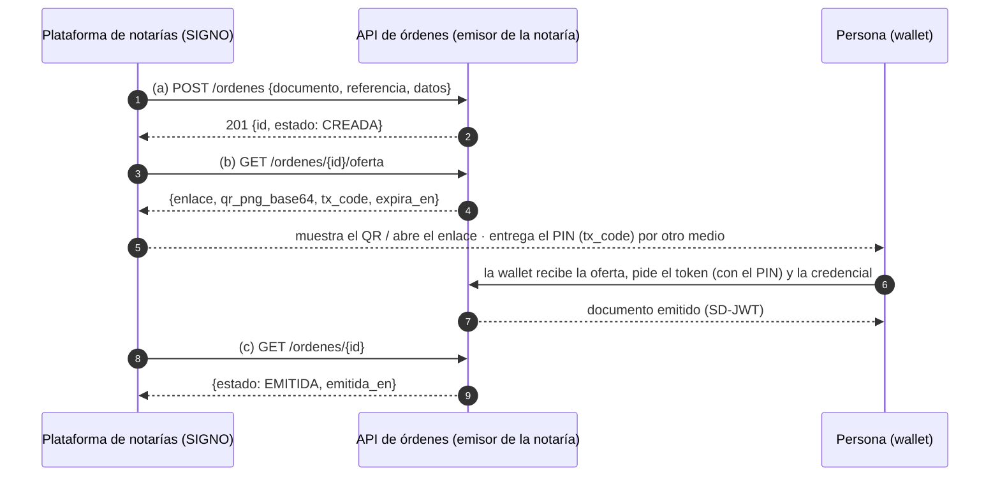
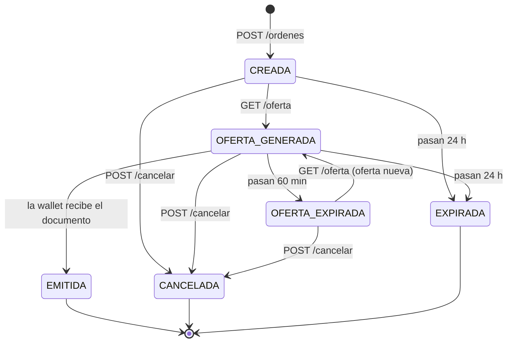

# API REST de órdenes de emisión · documento de consumo

**Para:** plataforma de notarías (SIGNO QA) · **De:** equipo de la notaría de ejemplo (Avance) · **Versión:** 1 · **Fecha:** 4-nov-2026

La plataforma de notarías **no implementa el protocolo de emisión** (OpenID4VCI). Solo hace tres cosas, y el emisor de la notaría hace el resto:

| | Qué hace la plataforma | Llamada |
|---|---|---|
| (a) | Crear la orden de emisión de un documento | `POST /ordenes` |
| (b) | Obtener el QR / enlace de oferta para que la persona lo reciba en su wallet | `GET /ordenes/{id}/oferta` |
| (c) | Consultar el estado del proceso | `GET /ordenes/{id}` |

Además: `GET /documentos` (qué documentos y campos hay) y `POST /ordenes/{id}/cancelar`.

## 1. Entorno y acceso

| | |
|---|---|
| **URL base (pruebas)** | `https://civica-desarrollo.avance.org.co/notaria-issuer/api/v1` |
| **Autenticación** | Cabecera `X-API-Key: <clave>` en **todas** las llamadas. La clave se entrega por canal aparte (no está en este documento). Cada cliente tiene su clave y solo ve sus propias órdenes. |
| **Formato** | JSON UTF-8 (`Content-Type: application/json` en los POST). Fechas ISO 8601 en UTC (`2026-11-04T13:03:01Z`); las que se envían como dato del documento van `AAAA-MM-DD`. |
| **Colección Postman** | `Integracion-Notarias.postman_collection.json` + `Integracion.postman_environment.json` (escribir la `api_key`). 24 pruebas con comprobaciones automáticas. |

## 2. Flujo



La plataforma nunca habla con la wallet ni ve las claves de la persona: solo orquesta con estas tres llamadas.

## 3. Estados de la orden



| Estado | Significa | Qué hacer |
|---|---|---|
| `CREADA` | La orden existe; aún no hay oferta | Pedir la oferta (b) |
| `OFERTA_GENERADA` | Hay un QR vigente; se espera a la wallet | Esperar y consultar (c) |
| `OFERTA_EXPIRADA` | El QR venció (60 min) o el emisor se reinició | Pedir la oferta otra vez: se genera una nueva |
| `EMITIDA` | **Final.** La wallet ya recibió el documento | Cerrar el trámite |
| `CANCELADA` | **Final.** Cancelada con `/cancelar` | — |
| `EXPIRADA` | **Final.** La orden venció (24 h) sin emitirse | Crear una orden nueva |

## 4. Operaciones

### (a) Crear la orden · `POST /ordenes`

| Campo | Tipo | Descripción |
|---|---|---|
| `documento` | texto, obligatorio | Identificador del documento (ver el catálogo, sección 5) |
| `referencia` | texto 1–100, obligatorio | Identificador del trámite **en la plataforma**. Es la llave de idempotencia (por cliente) |
| `datos` | objeto, obligatorio | Campos del documento (solo texto o números). Ver el catálogo |

```bash
curl -s -X POST "$BASE_URL/ordenes" -H "X-API-Key: $API_KEY" -H "Content-Type: application/json" -d '{
  "documento": "co.notaria.fe_de_vida",
  "referencia": "SIGNO-000123",
  "datos": {
    "titular_nombre": "Ana María Pérez Gómez",
    "titular_documento": "1020304050",
    "medio_identificacion": "Cédula de ciudadanía",
    "entidad_destino": "Colpensiones",
    "vigente_hasta": "2027-12-31"
  }
}'
```

**201 Created** (**200** si la `referencia` ya existía con los mismos datos: se devuelve la misma orden)

```json
{
  "id": "034e22be-724f-49ec-beba-0a271193461a",
  "referencia": "SIGNO-000123",
  "documento": "co.notaria.fe_de_vida",
  "estado": "CREADA",
  "creada_en": "2026-11-04T13:03:58.868321Z",
  "expira_en": "2026-11-05T13:03:58.867864Z",
  "oferta": null,
  "emitida_en": null
}
```

Reglas: no se aceptan campos que no estén en el catálogo ni los que pone la notaría (número de protocolo, fecha, notario, país emisor…). Las fechas se validan (`vigente_hasta` no puede estar en el pasado; `fecha_nacimiento` no puede ser futura…). Para los documentos con archivo (autenticación de firma, reconocimiento, copia de escritura) se envía el **nombre, el SHA-256 (64 hex) y el tamaño en bytes (1 a 50 MB)** del archivo, no el archivo.

### (b) Obtener el QR / enlace de oferta · `GET /ordenes/{id}/oferta`

```json
{
  "orden_id": "034e22be-724f-49ec-beba-0a271193461a",
  "estado": "OFERTA_GENERADA",
  "enlace": "openid-credential-offer://credential_offer?credential_offer=%7B%22credential_issuer%22…",
  "qr_png_base64": "data:image/png;base64,iVBORw0KGgo…",
  "tx_code": "86338",
  "expira_en": "2026-11-04T14:03:01.983664Z",
  "regenerada": false
}
```

- `enlace`: oferta OpenID4VCI. En el **mismo teléfono** se abre con la wallet; en pantalla de computador se muestra el QR.
- `qr_png_base64`: imagen PNG lista para ``.
- `tx_code`: **PIN de 5 dígitos** que la wallet pide a la persona. **No viaja dentro del QR**: la plataforma debe entregárselo por otro medio (correo, SMS, en pantalla del funcionario…).
- Mientras la oferta no venza, llamar de nuevo devuelve la misma. Si venció, genera una nueva y `regenerada` es `true`.

### (c) Consultar el estado · `GET /ordenes/{id}`

```json
{
  "id": "034e22be-724f-49ec-beba-0a271193461a",
  "referencia": "SIGNO-000123",
  "documento": "co.notaria.fe_de_vida",
  "estado": "OFERTA_GENERADA",
  "creada_en": "2026-11-04T13:03:58.868321Z",
  "expira_en": "2026-11-05T13:03:58.867864Z",
  "oferta": { "generada_en": "2026-11-04T13:03:01.984383Z", "expira_en": "2026-11-04T14:03:01.983664Z" },
  "emitida_en": null,
  "eventos": [
    { "evento": "CREADA", "detalle": { "cliente": "SIGNO" }, "en": "2026-11-04T13:03:58.868321Z" },
    { "evento": "OFERTA_GENERADA", "detalle": { "expira_en": "2026-11-04T14:03:01.983664Z" }, "en": "2026-11-04T13:03:01.984383Z" }
  ]
}
```

Recomendación: consultar cada 3–5 s mientras la persona está frente a la pantalla, y cada pocos minutos después. `eventos` es la bitácora (`CREADA`, `OFERTA_GENERADA`, `OFERTA_REGENERADA`, `EMITIDA`, `CANCELADA`).

### Cancelar · `POST /ordenes/{id}/cancelar`

Cuerpo opcional `{"motivo": "…"}`. Devuelve la orden en `CANCELADA`. **409** si ya estaba en un estado final.

### Catálogo · `GET /documentos`

`{"documentos": [{"documento", "vct", "nombre", "campos_requeridos": [], "campos_opcionales": []}]}`

## 5. Documentos y campos

Solo se envían los campos que escribe la plataforma. Todos son texto; las fechas, `AAAA-MM-DD`.

| `documento` | Nombre | Campos requeridos | Opcionales |
|---|---|---|---|
| `co.notaria.declaracion_extraproceso` | Declaración extraproceso | `declarante_nombre`, `declarante_documento`, `finalidad`, `declaracion`, `declarante_estado_civil`, `declarante_domicilio` | `testigos` |
| `co.notaria.fe_de_vida` | Fe de vida | `titular_nombre`, `titular_documento`, `medio_identificacion`, `entidad_destino`, `vigente_hasta` | — |
| `co.notaria.permiso_salida_menor` | Permiso de salida de menor | `otorgante_nombre`, `otorgante_documento`, `calidad`, `menor_nombre`, `menor_documento`, `destino`, `fecha_salida`, `fecha_regreso`, `acompanante`, `otro_progenitor`, `proposito_viaje` | `acompanante_documento` |
| `co.notaria.registro_civil_nacimiento` | Registro civil de nacimiento | `inscrito_nombre`, `fecha_nacimiento`, `lugar_nacimiento`, `sexo`, `progenitor_nombre`, `progenitor_documento`, `calidad`, `otro_progenitor`, `nuip`, `indicativo_serial`, `hora_nacimiento`, `certificado_nacido_vivo`, `madre_nombre`, `madre_documento` | `padre_nombre`, `padre_documento` |
| `co.notaria.autenticacion_firma` | Autenticación de firma | `firmante_nombre`, `firmante_documento`, `documento_nombre`, `documento_sha256`, `documento_bytes` | — |
| `co.notaria.constancia_copia_escritura` | Constancia de copia de escritura | `solicitante_nombre`, `solicitante_documento`, `escritura_numero`, `escritura_fecha`, `notaria_origen`, `documento_nombre`, `documento_sha256`, `documento_bytes`, `numero_copia`, `acto_o_contrato`, `folios` | — |
| `co.notaria.poder_especial` | Poder especial | `poderdante_nombre`, `poderdante_documento`, `apoderado_nombre`, `apoderado_documento`, `facultades`, `vigente_hasta`, `asunto` | — |
| `co.notaria.reconocimiento_documento` | Reconocimiento de documento | `firmante_nombre`, `firmante_documento`, `documento_nombre`, `documento_sha256`, `documento_bytes`, `numero_folios` | — |
| `co.notaria.declaracion_convivencia` | Declaración de convivencia | `declarante_nombre`, `declarante_documento`, `companero_nombre`, `companero_documento`, `convivencia_desde`, `vigente_hasta`, `estado_civil_declarante`, `estado_civil_companero`, `domicilio_comun`, `entidad_destino` | `testigos` |

## 6. Errores

Todos los errores tienen la misma forma: `{"error": {"codigo": "…", "mensaje": "…", …}}`.

| HTTP | `codigo` | Cuándo |
|---|---|---|
| 400 | `cuerpo_invalido`, `documento_desconocido` (trae `validos`), `referencia_invalida`, `datos_invalidos`, `campos_faltantes` (trae `campos`), `campos_desconocidos` (trae `campos`) | La petición está mal formada |
| 401 | `no_autenticado` | Falta `X-API-Key` o no es válida |
| 404 | `orden_no_encontrada` | El id no existe o es de otro cliente (también si no es un UUID) |
| 409 | `referencia_en_uso` · `orden_emitida` · `orden_cancelada` · `estado_final` | Conflicto con el estado o con una orden previa |
| 410 | `orden_expirada` | Se pidió la oferta de una orden vencida (24 h) |
| 422 | `datos_no_validos` | Los datos están completos pero no son válidos (fecha imposible, huella mal formada, archivo demasiado grande) |

## 7. Qué se puede probar hoy y qué no

- **Probado de extremo a extremo por HTTP** (24 pruebas automáticas contra el sistema real): autenticación, crear, idempotencia, conflicto, validaciones, oferta, estado, cancelación.
- **Requiere una wallet:** pasar de `OFERTA_GENERADA` a `EMITIDA`. La wallet debe abrir el `enlace`, aceptar la oferta y escribir el `tx_code`. Al recibir el documento el emisor cierra la orden solo. Hasta que se pruebe con una wallet real esa transición está verificada solo a nivel de base de datos.
- **Limitaciones del prototipo:** una sola clave por cliente, sin límite de peticiones, sin avisos (webhook) —el estado se consulta—, y las ofertas se pierden si el emisor se reinicia (el estado pasa a `OFERTA_EXPIRADA` y basta pedir la oferta de nuevo).
