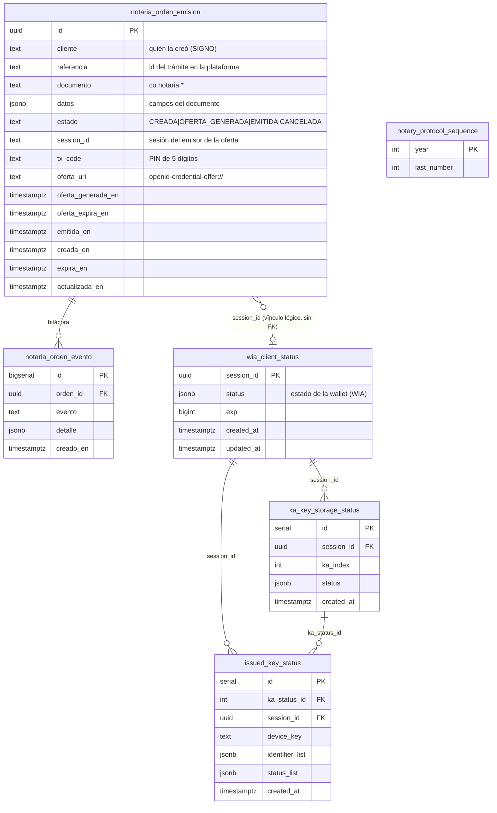

# Modelo entidad-relación · base de datos del emisor de la notaría (prototipo inicial)

**Base:** PostgreSQL 16 · `notaria_issuer` (contenedor `postgres-notaria-issuer`, red interna) · **Fecha:** 4-nov-2026
**Esquema completo (DDL):** [`esquema-bd.sql`](esquema-bd.sql) — generado con `pg_dump` de la base real.

Son **6 tablas**: dos nuevas, que respaldan la API de órdenes de emisión (las que la plataforma de notarías ve registrar cuando consume los endpoints desde Postman), y cuatro técnicas del emisor EUDI.

## 1. Diagrama



`notary_protocol_sequence` no tiene relaciones: es el contador del número de protocolo (`2026-00001`), una fila por año.

## 2. Diccionario de datos

### `notaria_orden_emision` — la orden de emisión (a)
| Columna | Tipo | Nulo | Descripción |
|---|---|---|---|
| `id` | uuid | no | **PK.** Identificador público de la orden (el `{id}` de la API) |
| `cliente` | text | no | Cliente de la API que la creó (hoy `SIGNO`) |
| `referencia` | text | no | Identificador del trámite en la plataforma. **Único por `cliente`** (`uq_orden_cliente_referencia`): hace la creación idempotente |
| `documento` | text | no | Documento a emitir (`co.notaria.fe_de_vida`, …) |
| `datos` | jsonb | no | Campos del documento, ya validados |
| `estado` | text | no | Guardado: `CREADA`, `OFERTA_GENERADA`, `EMITIDA`, `CANCELADA` (restricción `CHECK`). `OFERTA_EXPIRADA` y `EXPIRADA` se calculan al consultar, por las fechas |
| `session_id` | text | sí | Sesión del emisor que sostiene la oferta vigente; la usa el emisor para cerrar la orden al entregar el documento (índice `idx_orden_session`) |
| `tx_code` | text | sí | PIN de 5 dígitos de la oferta |
| `oferta_uri` | text | sí | Enlace `openid-credential-offer://…` |
| `oferta_generada_en`, `oferta_expira_en` | timestamptz | sí | Vida de la oferta (60 min) |
| `emitida_en` | timestamptz | sí | Cuándo la wallet recibió el documento |
| `creada_en` | timestamptz | no | Alta de la orden |
| `expira_en` | timestamptz | no | Vence a las 24 h de creada |
| `actualizada_en` | timestamptz | no | Último cambio |

### `notaria_orden_evento` — bitácora de la orden (c)
| Columna | Tipo | Nulo | Descripción |
|---|---|---|---|
| `id` | bigserial | no | **PK** |
| `orden_id` | uuid | no | **FK → `notaria_orden_emision.id`** (`ON DELETE CASCADE`) |
| `evento` | text | no | `CREADA`, `OFERTA_GENERADA`, `OFERTA_REGENERADA`, `EMITIDA`, `CANCELADA` |
| `detalle` | jsonb | sí | Datos del evento (cliente, vencimiento, motivo…) |
| `creado_en` | timestamptz | no | Momento del evento |

### `wia_client_status` — estado de la wallet (técnica del emisor EUDI)
`session_id` uuid **PK** · `status` jsonb (estado de revocación de la wallet, de su *Wallet Instance Attestation*) · `exp` bigint · `created_at`, `updated_at`.

### `ka_key_storage_status` — claves certificadas (*key attestation*)
`id` serial **PK** · `session_id` **FK → wia_client_status** · `ka_index` int · `status` jsonb · `created_at`. Único (`session_id`, `ka_index`).

### `issued_key_status` — claves a las que se emitió un documento
`id` serial **PK** · `ka_status_id` **FK → ka_key_storage_status.id** · `session_id` **FK → wia_client_status** · `device_key` text · `identifier_list` jsonb · `status_list` jsonb · `created_at`. Único (`ka_status_id`, `device_key`).

### `notary_protocol_sequence` — consecutivo del protocolo
`year` int **PK** · `last_number` int. Cada documento emitido toma el siguiente número del año (`2026-00001`).

## 3. Cardinalidades

- Una orden tiene **0..N eventos** (siempre al menos `CREADA`).
- Una orden se enlaza con **como mucho una** sesión de la wallet (`session_id`): vínculo lógico, no es clave foránea, porque la fila de `wia_client_status` nace recién cuando la wallet pide el token.
- Una sesión de wallet tiene **0..N** claves certificadas, y cada clave certificada **0..N** claves emitidas.

## 4. Cómo ver los registros mientras se prueba desde Postman

1. **Conexión (cliente SQL, p. ej. DBeaver):** host `127.0.0.1`, puerto **5442**, base `notaria_issuer`, usuario `notaria_issuer`. La clave y el acceso desde fuera del servidor se entregan por canal aparte (el puerto solo escucha en la máquina del servidor: hay que entrar por túnel SSH o desde el propio servidor).
2. **Consultas útiles**

```sql
-- Las órdenes que creó la plataforma, la más reciente primero
SELECT id, referencia, documento, estado, creada_en, oferta_generada_en, emitida_en
FROM notaria_orden_emision ORDER BY creada_en DESC;

-- La bitácora de una orden
SELECT evento, detalle, creado_en FROM notaria_orden_evento WHERE orden_id = '<id>' ORDER BY id;

-- Qué se registra por cada llamada de Postman
--   POST /ordenes             -> 1 fila en notaria_orden_emision (estado CREADA) + evento CREADA
--   GET  /ordenes/{id}/oferta -> estado OFERTA_GENERADA, session_id, tx_code, oferta_uri + evento OFERTA_GENERADA
--   POST /ordenes/{id}/cancelar -> estado CANCELADA + evento CANCELADA
--   la wallet recibe el documento -> estado EMITIDA, emitida_en + evento EMITIDA
```

## 5. Fuera de esta base

La notaría de ejemplo con portal propio (`verifiers/notaria`, ruta `/notaria/`) guarda su protocolo de trámites en un archivo JSON, no en PostgreSQL: no forma parte de este modelo ni de la API de órdenes.
